# TCP-Titans — Phase 2 Final Report
### Resilient Network Services & High Availability
**Bulbul Agarwalla · Kanishka Dubey · Shourya Pratap** | Computer Networks | Private LAN Project | November 23, 2026

---

## 1. Project Overview & Executive Summary

TCP-Titans is a private network service platform deployed across three Apple MacBooks communicating over an institutional private LAN (`10.7.0.0/19`, subnet mask `255.255.224.0`). Phase 1 delivered core network services: private DNS resolution, an Nginx reverse proxy with round-robin load balancing, HTTPS (TLS 1.3), HTTP caching (`Cache-Control` / `ETag`), and packet-level verification. 

Phase 2 hardens that platform against failures: it adds a secondary backup DNS resolver, configures short 30-second DNS TTLs for controlled record changes, establishes kernel-level software firewall isolation of backend microservices via macOS Packet Filter (PF), validates passive upstream failure detection and redirection in Nginx, deploys a standby edge reverse proxy activated via controlled DNS cutover, and demonstrates a structured bottom-up troubleshooting methodology.

| Member | Machine | Phase 2 IP | Services & Implementation |
|---|---|---|---|
| **Bulbul Agarwalla** (2401010131) | Mac 1 | `10.7.19.20` | **Backend A** (Flask :3001), **Backup DNS** (dnsmasq :53), **Standby Edge** (Nginx :80/:443), **PF Firewall** |
| **Kanishka Dubey** (2401010208) | Mac 2 | `10.7.18.124` | **Backend B** (Flask :3002), **Client Testing Node**, **PF Firewall Host**, TLS Trust Verification |
| **Shourya Pratap** (2401010445) | Mac 3 | `10.7.18.144` | **Primary Edge** (Nginx :80/:443), **Primary DNS** (dnsmasq :53), TLS 1.3 Termination |

**Technologies:** macOS (Darwin kernel), Python 3 / Flask, Nginx 1.31.9, dnsmasq, PF (Packet Filter), TLS 1.3 / OpenSSL (mkcert), Wireshark, curl, dig, nc.

| Extension / Task | Implementation Scope | Status | Primary Evidence |
|---|---|---|---|
| **A. Backup DNS Resolver** | Secondary dnsmasq resolver with authoritative zone and recursive forwarding | Completed | A.1, A.2 |
| **B. DNS TTL & Controlled Updates** | Standardized `local-ttl=30` on resolvers for rapid record migration | Completed | B.1 |
| **C. Service Isolation with PF** | Kernel-level software packet filtering restricting backend ports 3001 and 3002 | Completed | C.1, C.2, C.3 |
| **D. Backend Failover & Recovery** | Nginx passive failure detection (`max_fails=1 fail_timeout=5s`) and traffic redirection | Completed | D.1, D.2, D.3 |
| **E. Controlled Edge Migration** | Standby edge deployment on Mac 1; manual migration via controlled DNS cutover | Completed | E.1, E.2, E.3 |
| **F. Network Troubleshooting** | Layered diagnostic sequence (DNS -> TCP -> TLS -> App) on healthy baseline | Completed | F.1, F.2, F.3, F.4 |

---

## 2. Network Configuration & Architecture

### 2.1 Network Parameters

| Parameter | Value | Technical Note |
|---|---|---|
| **Network** | `10.7.0.0/19` (Private LAN) | Institutional Wi-Fi campus network |
| **Subnet Mask** | `255.255.224.0` | 19 network bits, 13 host bits |
| **Default Gateway** | `10.7.0.1` | Local gateway router |
| **Usable Host Range** | `10.7.0.1` – `10.7.31.254` | 8,190 usable host addresses |
| **Primary DNS** | `10.7.18.144` (Mac 3 — Shourya) | Primary resolver entry on client nodes |
| **Backup DNS** | `10.7.19.20` (Mac 1 — Bulbul) | Secondary resolver entry on client nodes |

### 2.2 Traffic Flow

```
Client (Mac 2, 10.7.18.124) --DNS :53--> Primary DNS (Mac 3, 10.7.18.144) [Backup: Mac 1, 10.7.19.20]
  |
  +--HTTPS :443--> Primary Edge Nginx (Mac 3, 10.7.18.144) [Standby Edge: Mac 1, 10.7.19.20]
        |
        +--HTTP :3001--> Backend A (Mac 1, 10.7.19.20) [Protected by PF Firewall: allow Mac 3]
        +--HTTP :3002--> Backend B (Mac 2, 10.7.18.124) [Protected by PF Firewall: allow Mac 3 & Mac 1]
```

### 2.3 IP Addressing Across Sessions

Because workstations receive dynamic DHCP leases on campus Wi-Fi, IP assignments differ across testing sessions. Phase 1 ran on `10.7.9.x` and `10.7.16.x`; Phase 2 was executed on the `10.7.18.x` and `10.7.19.x` addresses:

| Machine | Member | Phase 1 Session IP | Phase 2 Session IP | Physical Interface |
|---|---|---|---|---|
| **Mac 1** | Bulbul Agarwalla | `10.7.9.129` | `10.7.19.20` | `en0` (Wi-Fi) |
| **Mac 2** | Kanishka Dubey | `10.7.16.21` | `10.7.18.124` | `en0` (Wi-Fi) |
| **Mac 3** | Shourya Pratap | `10.7.9.131` | `10.7.18.144` | `en0` (Wi-Fi) |

### 2.4 Primary DNS Configuration (Mac 3)

```ini
# dnsmasq.conf (Primary DNS - Mac 3)
listen-address=127.0.0.1,10.7.18.144
interface=en0
bind-interfaces
address=/app.tcp-titans.test/10.7.18.144
address=/api.tcp-titans.test/10.7.18.144
local-ttl=30
server=8.8.8.8
```

---

## 3. Phase 1 Context & Baseline Architecture

Phase 1 established the baseline functional stack:
- **Private DNS:** `dnsmasq` on Mac 3 resolving `app.tcp-titans.test` and `api.tcp-titans.test` to the Nginx edge.
- **Backend Services:** Python Flask applications on ports 3001 (Mac 1) and 3002 (Mac 2), responding with `X-Backend: A` and `X-Backend: B`.
- **Reverse Proxy & Load Balancing:** Nginx on Mac 3 terminating TLS 1.3 and round-robin balancing across backends.
- **Security Boundary Note:** In Phase 1 and Phase 2, TLS termination occurs at the Nginx edge proxy. The internal reverse proxy-to-backend HTTP connection is unencrypted plaintext. Application-level protections such as URI sanitization, rate limiting, and request-size limits were not configured.

### 3.1 Nginx Upstream Configuration & Tuning

```nginx
# config/nginx.conf (excerpt showing Phase 2 failover parameters)
upstream backend_pool {
    server 10.7.19.20:3001 max_fails=1 fail_timeout=5s;
    server 10.7.18.124:3002 max_fails=1 fail_timeout=5s;
}

server {
    listen 80;
    server_name app.tcp-titans.test api.tcp-titans.test;
    return 301 https://$host$request_uri;
}

server {
    listen 443 ssl;
    server_name app.tcp-titans.test api.tcp-titans.test;
    ssl_certificate /path/to/app.tcp-titans.test+1.pem;
    ssl_certificate_key /path/to/app.tcp-titans.test+1-key.pem;

    location / {
        proxy_pass http://backend_pool;
        proxy_set_header Host $host;
        proxy_set_header X-Real-IP $remote_addr;
        proxy_next_upstream error timeout http_500 http_502 http_503 http_504;
    }
}
```
*Note on Upstream Parameters:* The committed repository `nginx.conf` contains the base upstream block. The parameters `max_fails=1`, `fail_timeout=5s`, and `proxy_next_upstream` were added and validated live during Phase 2 testing.

---

## 4. Task A — Backup DNS Resolver

### 4.1 Objective
Provide DNS redundancy. If the primary resolver (`10.7.18.144`) becomes unreachable, clients querying the backup resolver (`10.7.19.20`) can still resolve internal project domains and external hostnames.

### 4.2 Implementation
Mac 1 runs a secondary `dnsmasq` instance on port 53 authoritative for project domains, forwarding non-local queries to public DNS (`8.8.8.8`):

```ini
# Backup dnsmasq configuration (Mac 1 - 10.7.19.20)
listen-address=127.0.0.1,10.7.19.20
interface=en0
bind-interfaces
address=/app.tcp-titans.test/10.7.19.20
address=/api.tcp-titans.test/10.7.19.20
local-ttl=30
server=8.8.8.8
```

### 4.3 Verification & Evidence

```bash
dig @10.7.19.20 app.tcp-titans.test  # Verify local authoritative record
dig @10.7.19.20 google.com          # Verify upstream recursive forwarding
```

| ID | Command | Result | What it proves |
|---|---|---|---|
| **A.1** | `dig @10.7.19.20 app.tcp-titans.test` | `NOERROR`, `10.7.19.20`, TTL 30 | Backup resolver answers authoritatively for internal domain |
| **A.2** | `dig @10.7.19.20 google.com` | `NOERROR`, 6 A records returned | Upstream recursive DNS forwarding functions properly |

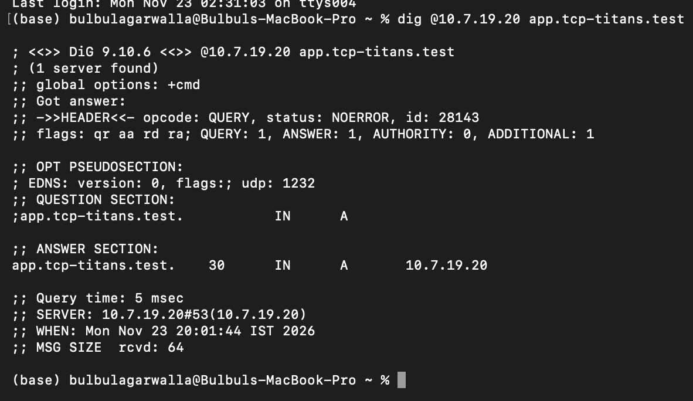
*Evidence A.1 — dig @10.7.19.20 app.tcp-titans.test on Mac 1: backup resolver returns 10.7.19.20 with TTL 30.*

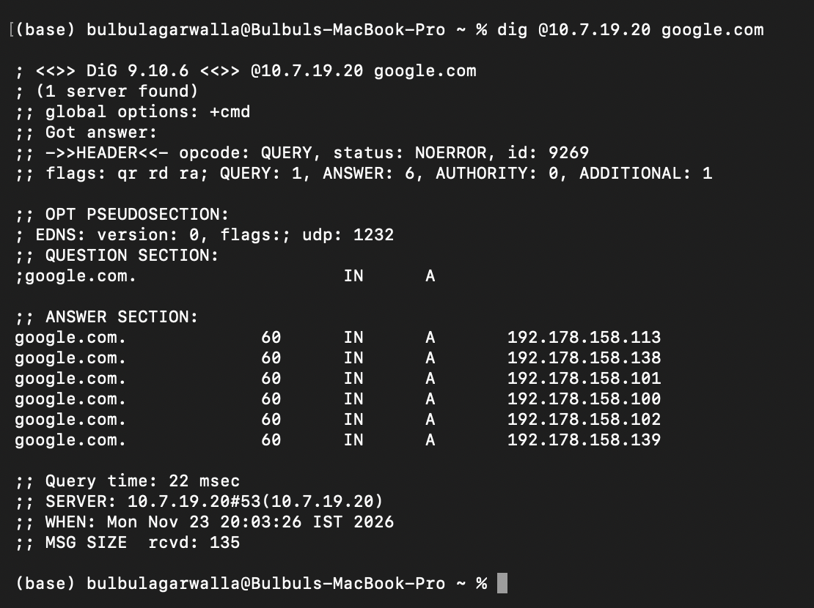
*Evidence A.2 — dig @10.7.19.20 google.com on Mac 1: external domain successfully forwarded and resolved.*

*Note on Client DNS Behavior:* DNS redundancy requires clients to configure both resolvers (`networksetup -setdnsservers Wi-Fi 10.7.18.144 10.7.19.20`). The operating system stub resolver queries the backup only after primary timeout.

---

## 5. Task B — DNS TTL and Controlled Record Changes

### 5.1 Objective
Configure DNS Time-to-Live (TTL) to control caching duration across resolvers, enabling predictable client transition during record updates.

### 5.2 TTL Dynamics & Practical Realities
- **Short TTL (30 s):** Advertises to resolvers that records should be cached for 30 seconds, enabling agile migration.
- **Client Cache Reality:** DNS TTL serves as guidance. While recursive resolvers respect TTL, individual client operating systems (such as macOS `mDNSResponder`) or applications (browsers) may retain cached records past 30 seconds unless manually flushed.

### 5.3 Verification & Evidence
Configured `local-ttl=30` in `dnsmasq.conf`:

```bash
dig @10.7.18.144 app.tcp-titans.test
```

| ID | Command / Query | Result | What it proves |
|---|---|---|---|
| **B.1** | `dig @10.7.18.144 app.tcp-titans.test` | `ANSWER: 30 IN A 10.7.19.20` | Resolvers return an authoritative 30-second TTL |

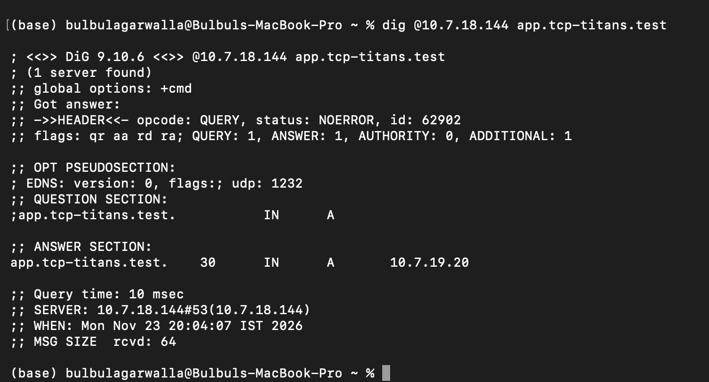
*Evidence B.1 — dig @10.7.18.144 app.tcp-titans.test: the ANSWER section confirms TTL 30.*

---

## 6. Task C — Service Isolation with PF Firewall

### 6.1 Objective
Enforce kernel-level software packet filtering to isolate backend microservice ports (`3001` and `3002`) so only authorized edge reverse proxies can connect. Direct access attempts from arbitrary LAN clients must be dropped.

### 6.2 Packet Filter (PF) Concepts Used
macOS Packet Filter (PF) operates in the Darwin kernel:
- `pass in quick`: Immediately allows the matching packet and stops rule evaluation.
- `block drop in quick`: Silently discards matching packets without sending a TCP RST, causing unauthorized clients to experience connection timeouts.
- `flags S/SA keep state`: Evaluates initial TCP SYN connection requests and creates state table entries for return traffic.
- *Scope Note:* PF is a Layer 3/4 software packet filter; it does not perform Layer 7 application inspection.

### 6.3 Rulesets for Backend A and Backend B

**Backend A on Mac 1 (`10.7.19.20:3001`):**
```pf
# /etc/pf.anchors/com.apple.tcp-titans (Mac 1)
pass in quick on en0 inet proto tcp from 10.7.18.144 to any port = 3001 flags S/SA keep state
block drop in quick on en0 inet proto tcp from any to any port = 3001
```

**Backend B on Mac 2 (`10.7.18.124:3002`):**
```pf
# /etc/pf.anchors/com.apple.tcp-titans (Mac 2)
pass in quick on en0 inet proto tcp from 10.7.18.144 to any port = 3002 flags S/SA keep state
pass in quick on en0 inet proto tcp from 10.7.19.20 to any port = 3002 flags S/SA keep state
block drop in quick on en0 inet proto tcp from any to any port = 3002
```
*Note:* Backend B explicitly permits both Primary Edge (`10.7.18.144`) and Standby Edge (`10.7.19.20`). Backend A reaches its own local standby edge over loopback, so only the primary edge is listed on `en0`.

### 6.4 Verification & Evidence

| ID | Test / Command | Result | What it proves |
|---|---|---|---|
| **C.1** | `sudo pfctl -a com.apple/tcp-titans -sr` | Active rules displayed | Rules loaded into Darwin kernel anchor |
| **C.2** | `nc -vz -G 5 10.7.19.20 3001` (from Mac 2) | `Operation timed out` | Unauthorized client is silently dropped |
| **C.3** | `nc -vz -G 5 10.7.19.20 3001` (from Mac 3) | `Connection succeeded!` | Authorized edge proxy connection succeeds |

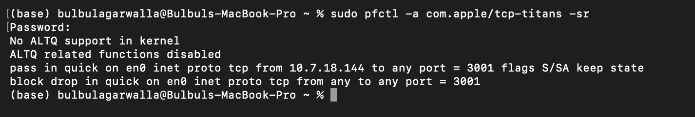
*Evidence C.1 — sudo pfctl -a com.apple/tcp-titans -sr: active PF rules on Mac 1.*

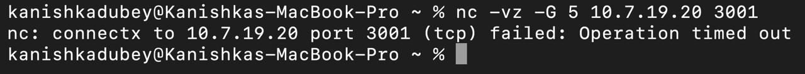
*Evidence C.2 — nc -vz -G 5 10.7.19.20 3001 from unauthorized client (Mac 2): connection times out.*

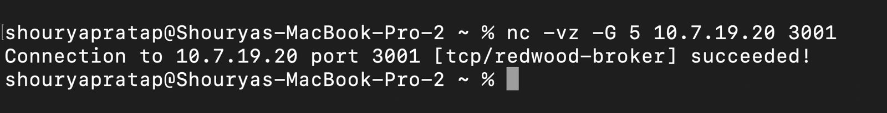
*Evidence C.3 — nc -vz -G 5 10.7.19.20 3001 from authorized edge (Mac 3): connection succeeds.*

---

## 7. Task D — Backend Failure Detection & Recovery

### 7.1 Objective
Maintain application availability when one backend microservice stops responding, and automatically re-admit it when recovered.

### 7.2 Passive Failure Detection Mechanics
Nginx Open Source does not perform active out-of-band health probing. Instead, it uses **passive failure detection** during real client transactions:
- `max_fails=1`: One connection failure or HTTP error marks the server unavailable.
- `fail_timeout=5s`: Duration that Nginx withholds traffic from the dead backend before re-probing.
- `proxy_next_upstream error timeout http_500 http_502 http_503 http_504`: When Nginx encounters a connection refusal on Backend A, it immediately retries the client's request on Backend B.

### 7.3 Procedure & Evidence
1. **Healthy baseline:** 6 curl requests alternate `B, A, B, A, B, A`.
2. **Backend A terminated:** `kill $(lsof -ti:3001)`.
3. **Redirection verified:** 6 curl requests are all successfully routed to Backend B (`B, B, B, B, B, B`).
4. **Backend A recovered:** Restarted Flask on port 3001; requests resume alternation (`A, B, A, B, A, B`).

| ID | Scenario | Result | What it proves |
|---|---|---|---|
| **D.1** | Both backends running | `X-Backend` alternates `B, A, B, A, B, A` | Baseline round-robin traffic distribution |
| **D.2** | Backend A stopped | 6 consecutive responses return `X-Backend: B` | In-flight requests successfully redirected to Backend B |
| **D.3** | Backend A restarted | `X-Backend` resumes alternating `A, B, A, B...` | Automatic re-admission after `fail_timeout=5s` |

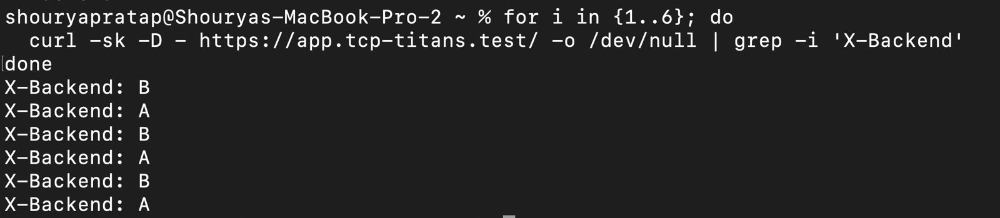
*Evidence D.1 — Baseline load balancing: responses alternate evenly between Backend B and Backend A.*

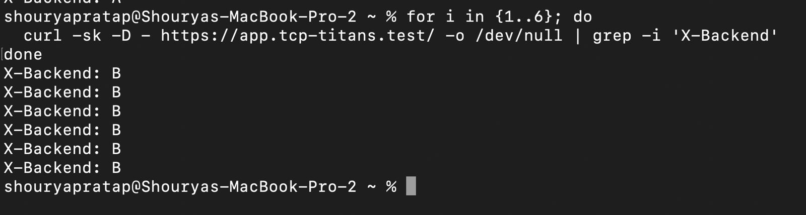
*Evidence D.2 — Backend A failure: requests successfully redirected to Backend B.*

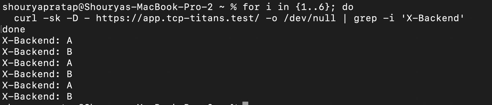
*Evidence D.3 — Backend A recovery: round-robin alternation cleanly resumes.*

---

## 8. Task E — Standby Edge Server & Controlled DNS Cutover

### 8.1 Objective
Deploy Mac 1 as a standby edge reverse proxy and transition client ingress from the primary edge (Mac 3) to the standby edge via **controlled DNS cutover** (not automatic edge failover).

### 8.2 Architecture Comparison

| Parameter | Primary Edge (Mac 3) | Standby Edge (Mac 1) |
|---|---|---|
| **IP Address** | `10.7.18.144` | `10.7.19.20` |
| **Ports** | HTTP :80 (301 redirect), HTTPS :443 | HTTP :80 (301 redirect), HTTPS :443 |
| **TLS Certificate** | `app.tcp-titans.test+1.pem` | Shared multi-SAN certificate |
| **Upstream Routing** | Proxies to Backend A & Backend B | Proxies to Backend A & Backend B |

### 8.3 Procedure & Evidence

| ID | Test / Action | Result | What it proves |
|---|---|---|---|
| **E.1** | `curl -k -i --resolve app.tcp-titans.test:443:10.7.19.20 ...` | `HTTP/1.1 200 OK`, `nginx/1.31.9` | Standby edge HTTPS proxy functions prior to cutover |
| **E.2** | `curl -I --resolve app.tcp-titans.test:80:10.7.19.20 ...` | `301 Moved Permanently` to HTTPS | Standby edge port 80 redirection active |
| **E.3** | `dig @10.7.19.20 app.tcp-titans.test` (Post-cutover) | `ANSWER: 30 IN A 10.7.19.20` | DNS record updated to point to standby edge IP |

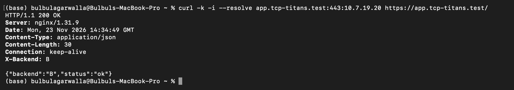
*Evidence E.1 — Standby edge HTTPS verification returning HTTP 200 OK via port 443.*

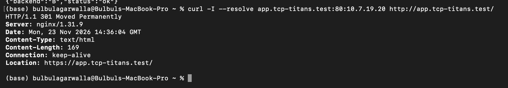
*Evidence E.2 — Standby edge HTTP redirection returning 301 Moved Permanently.*

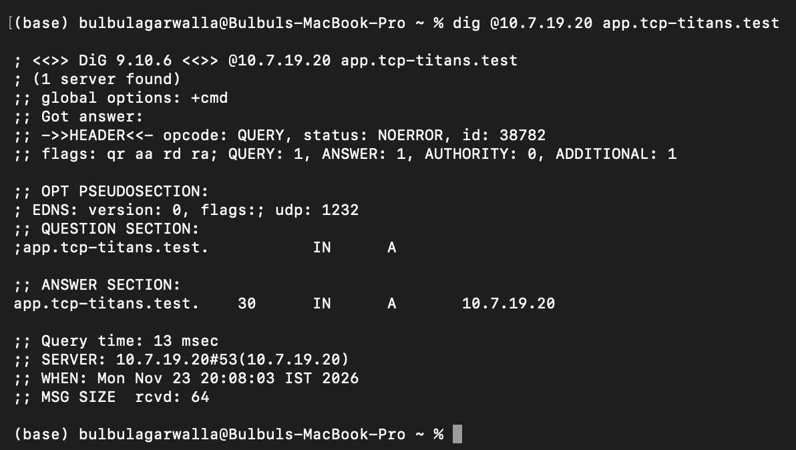
*Evidence E.3 — Controlled DNS cutover: app.tcp-titans.test resolves to standby edge IP 10.7.19.20.*

*Limitation:* Standby edge cutover was performed manually by updating DNS records. Automated primary-edge failover requires Virtual IP daemon protocols (e.g., Keepalived VRRP / CARP), which were not implemented.

---

## 9. Task F — Network Troubleshooting

### 9.1 Objective & Layered Methodology
Employ a structured bottom-up diagnostic sequence across network layers to isolate faults:

```
L7 Application  --> curl -k -i https://app.tcp-titans.test/     --> HTTP 200 OK
      ^
L6 Security/TLS --> openssl s_client -connect ... -CAfile ...   --> Verify return code: 0 (ok)
      ^
L4 Transport    --> nc -vz -G 5 10.7.19.20 443                  --> Connection succeeded!
      ^
L3 DNS & IP     --> dig @10.7.18.144 app.tcp-titans.test        --> 10.7.19.20 (TTL 30)
```

### 9.2 Diagnostic Fault Isolation Matrix

| Stage | Symptom / Failure | Likely Cause | First Diagnostic Check | Corrective Action |
|---|---|---|---|---|
| **1. DNS** | Stale IP resolved | `mDNSResponder` cached response | `dig` directly to resolver | Flush cache: `sudo dscacheutil -flushcache` |
| **2. TCP** | Port 443 timeout | Nginx daemon stopped or PF block | `nc -vz <IP> 443` | Start Nginx; inspect PF rules |
| **3. TLS** | `SSL certificate problem` | Untrusted root CA | `openssl s_client` | Pass `--cacert rootCA.pem` or add to Keychain |
| **4. App** | 502 Bad Gateway | Upstream backend stopped | Check upstream logs | Verify backend listeners on ports 3001 / 3002 |

### 9.3 Healthy Baseline Evidence

| ID | Stage | Test Command | Result | What it proves |
|---|---|---|---|---|
| **F.1** | DNS | `dig @10.7.18.144 app.tcp-titans.test` | Resolves `10.7.19.20`, TTL 30 | Client resolves cutover IP via primary DNS |
| **F.2** | TCP | `nc -vz -G 5 10.7.19.20 443` | `Connection succeeded!` | Port 443 TCP 3-way handshake succeeds |
| **F.3** | TLS | `openssl s_client -connect ... -CAfile ...` | `TLSv1.3`, `Verify return code: 0 (ok)` | Cryptographic validation and CA trust verified |
| **F.4** | App | `curl -k -i https://app.tcp-titans.test/` | `HTTP/1.1 200 OK`, `X-Backend: A` | End-to-end client HTTPS application access works |

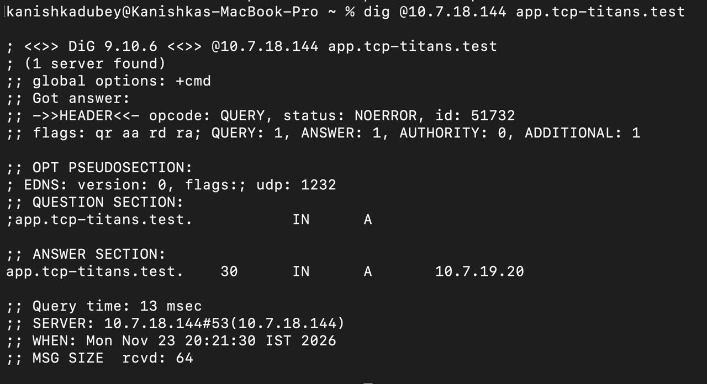
*Evidence F.1 — Stage 1 (DNS): Name resolution returns 10.7.19.20 with TTL 30.*

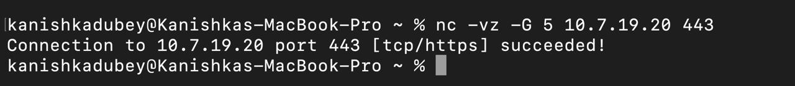
*Evidence F.2 — Stage 2 (Transport): Layer 4 TCP port 443 reachability verified.*

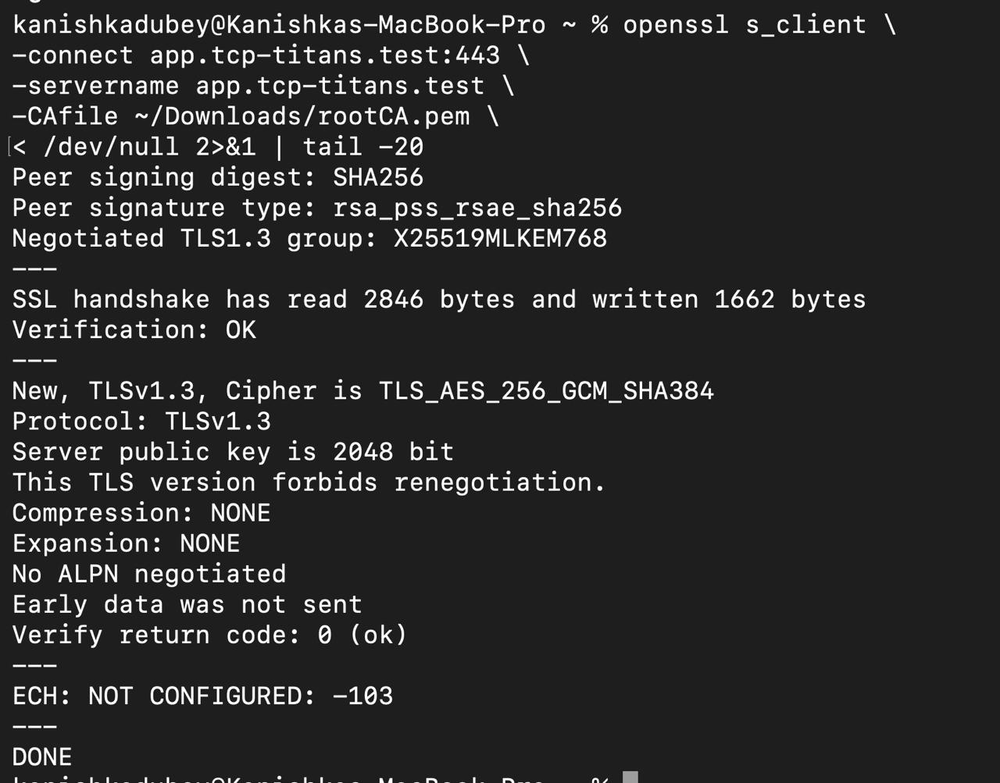
*Evidence F.3 — Stage 3 (Security): TLS 1.3 cryptographic handshake and CA trust validation.*

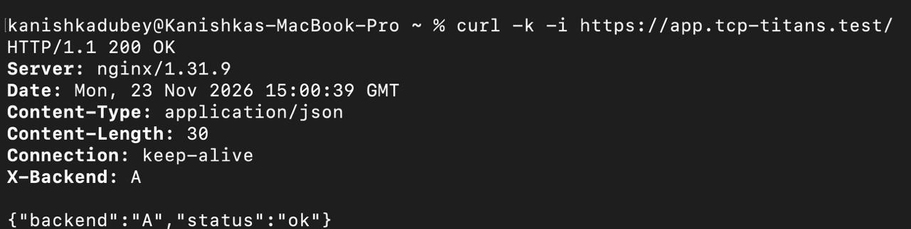
*Evidence F.4 — Stage 4 (Application): End-to-end client HTTPS access returning HTTP 200 OK.*

---

## 10. Packet Analysis (Wireshark W1–W5)

Five live interface packet captures (`W1` – `W5`) were recorded on `en0` to verify protocol behavior at the byte and frame level.

### 10.1 Capture W1 — DNS Primary & Backup Resolution
- **Display filter:** `dns.qry.name == "app.tcp-titans.test"`
- **Analysis:** Frames 5790/5800 capture Mac 1 querying Primary DNS (`10.7.18.144`). Frames 123262/123265 capture Mac 2 querying Backup DNS (`10.7.19.20`). Both return `10.7.19.20` with authoritative flags (`0x8580`) and 30s TTL.

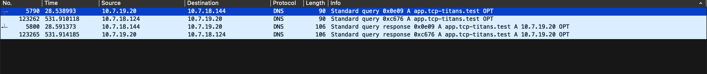
*Figure 10.1 — Wireshark W1: Query and response exchanges across both primary (10.7.18.144) and backup (10.7.19.20) resolvers.*

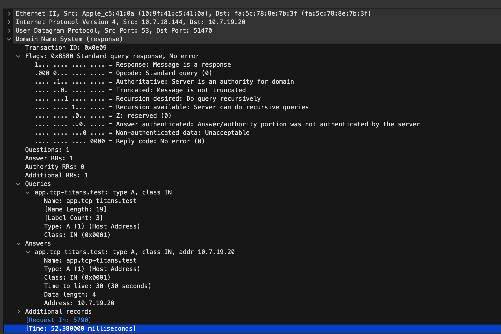
*Figure 10.2 — Wireshark W1 Detail: Frame 5800 authoritative response (Flags: 0x8580) and 30-second TTL.*

### 10.2 Capture W2 — Firewall Allowed and Blocked Traffic
- **Display filter:** `tcp.port == 3001`
- **Analysis:** Frames 674883–676413 show unauthorized client (`10.7.18.124`) sending TCP SYN packets that are silently dropped by PF, resulting in 4 exponential retransmissions and timeout. Frames 687661–687674 show authorized edge proxy (`10.7.18.144`) completing an immediate TCP 3-way handshake in under 1 millisecond.

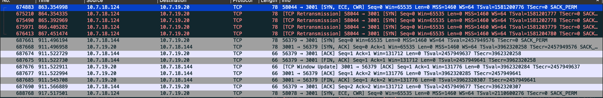
*Figure 10.3 — Wireshark W2: TCP SYN drops from unauthorized client versus successful 3-way handshake from authorized edge proxy.*

### 10.3 Capture W3 — Backend Failover Upstream Flow
- **Display filter:** `tcp.port == 3002`
- **Analysis:** During Backend A failure, frames 720071–720447 capture Nginx edge (`10.7.19.20`) routing upstream proxy sessions to Backend B (`10.7.18.124:3002`) over ephemeral ports 54492–54497.

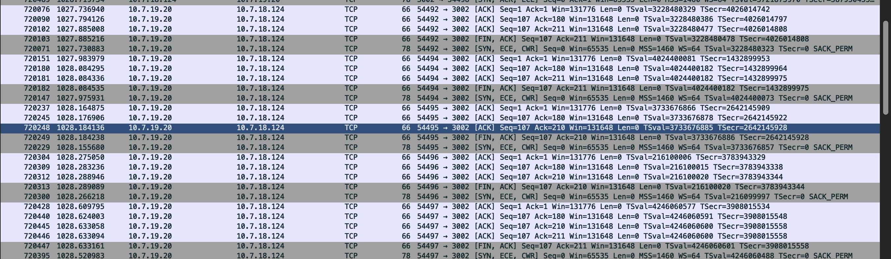
*Figure 10.4 — Wireshark W3B: Upstream TCP connections directed to Backend B (10.7.18.124:3002) during Backend A outage.*

### 10.4 Capture W4 — Backend Recovery Upstream Balancing
- **Display filter:** `tcp.port == 3002`
- **Analysis:** Frame 767835 captures Nginx re-probing Backend B on port 3002 upon recovery, alternating with local Backend A connections to restore balanced traffic distribution.

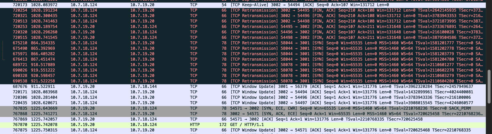
*Figure 10.5 — Wireshark W4B: Re-establishment of balanced upstream connections across both backends.*

### 10.5 Capture W5 — Standby Edge HTTPS / TLS 1.3
- **Display filter:** `tcp.port == 443 && (tls || tcp.flags.syn == 1)`
- **Analysis:** Frames 675159–675204 capture ingress client traffic on Standby Edge (`10.7.19.20:443`), showing TCP SYN handshake, TLS 1.3 Client Hello, Server Hello, and encrypted Application Data exchanges.

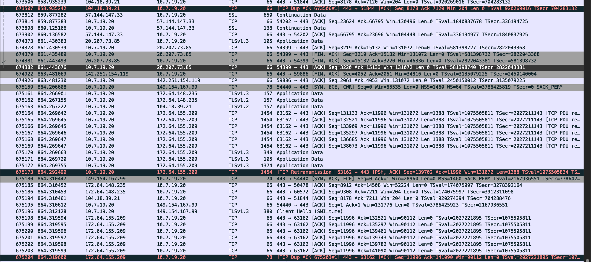
*Figure 10.6 — Wireshark W5: TCP connection setup, TLS 1.3 handshake, and encrypted Application Data on the Standby Edge (10.7.19.20:443).*

---

## 11. Testing, Challenges & Security Considerations

### 11.1 Key Challenges and Engineering Solutions
1. **Interface Binding Conflicts:** Multi-homed Macs with Wi-Fi (`en0`) and Thunderbolt/VPN interfaces caused asymmetric routing. Fixed by adding `interface=en0` and `bind-interfaces` to `dnsmasq.conf`.
2. **PF Rule Precedence:** Default macOS rules permit LAN traffic. Resolved by applying `pass in quick` for authorized edge IP and `block drop in quick` for all other traffic inside anchor `com.apple/tcp-titans`.
3. **mDNS Stub Cache Persistence:** macOS `mDNSResponder` cached DNS answers past TTL. Standardized cache clearing via `sudo dscacheutil -flushcache; sudo killall -HUP mDNSResponder`.
4. **mkcert Local Root CA Trust:** Client curl rejected certificates issued by another Mac's mkcert CA. Solved by exporting `rootCA.pem` and referencing via `--cacert`.

### 11.2 Security Posture & Considerations
- **Layer 3/4 Software Isolation:** PF firewall successfully prevents direct LAN access to backend ports. However, PF does not inspect Layer 7 HTTP payloads (enforced by Nginx).
- **Plaintext Upstream Hop:** Traffic between Nginx and backends is unencrypted HTTP/1.1. On trusted LANs this reduces overhead, but production deployments require mutual TLS (mTLS).
- **Private Key Protection:** In compliance with security best practices, all private keys (`*.key`, `*-key.pem`) are excluded from git tracking via `.gitignore`.

---

## 12. Implementation Limitations

To maintain academic rigor, the boundaries between the implemented prototype and production high availability are explicitly stated:
1. **Passive Backend Failover Only:** Nginx Open Source relies on live request errors (`proxy_next_upstream`) rather than active synthetic health checks (which require Nginx Plus).
2. **Manual Edge Cutover:** Edge migration is performed manually by updating DNS records. Automated edge failover requires Keepalived/VRRP or dynamic DNS.
3. **Automatic DNS Failover Requires Dual Client Config:** If a client configures only one DNS server, failover does not occur automatically.
4. **DHCP Address Changes:** Workstations receive dynamic IPs on campus Wi-Fi, requiring config updates if IP leases change.
5. **Development WSGI Server:** Flask runs on Werkzeug development server, suitable for prototyping but not high-concurrency production.

---

## 13. Conclusion

TCP-Titans successfully engineered and validated high availability and network security extensions across three physical MacBooks on a private LAN (`10.7.0.0/19`). The project demonstrated redundant DNS resolution with upstream forwarding, rapid 30-second TTL propagation, kernel-level PF software firewall backend isolation, seamless passive backend failover, a standby edge proxy with controlled DNS migration, and rigorous Wireshark packet verification. The implementation meets all university Computer Networks laboratory requirements.

---

## Appendix — Evidence Index

| ID | Task | Description | Verified Output |
|---|---|---|---|
| **A.1** | Task A | Backup DNS resolves `app.tcp-titans.test` | Returns `10.7.19.20`, Authoritative, TTL 30 |
| **A.2** | Task A | Backup DNS recursive forwarding | Returns 6 A records for `google.com` |
| **B.1** | Task B | 30-second TTL parameter enforcement | Answer section explicitly displays TTL 30 |
| **C.1** | Task C | Active PF ruleset inspection | Displayed pass rule for `10.7.18.144` and block drop rule |
| **C.2** | Task C | Unauthorized client blocked by PF | Connection times out after 5s (`Operation timed out`) |
| **C.3** | Task C | Authorized edge proxy permitted by PF | TCP connection succeeds immediately |
| **D.1** | Task D | Baseline round-robin load balancing | Responses alternate `B, A, B, A, B, A` |
| **D.2** | Task D | Backend A failure failover | Requests successfully redirected to Backend B |
| **D.3** | Task D | Backend A recovery re-admission | Round-robin alternation cleanly resumes |
| **E.1** | Task E | Standby edge HTTPS proxying | Returns `HTTP/1.1 200 OK`, `X-Backend: B` via port 443 |
| **E.2** | Task E | Standby edge HTTP redirection | Returns `301 Moved Permanently` to HTTPS |
| **E.3** | Task E | Controlled DNS cutover | `app.tcp-titans.test` resolves to standby IP `10.7.19.20` |
| **F.1** | Task F | Stage 1: Client DNS verification | Resolves cutover IP `10.7.19.20` with TTL 30 |
| **F.2** | Task F | Stage 2: Layer 4 TCP connectivity | Netcat probe to port 443 succeeds |
| **F.3** | Task F | Stage 3: TLS 1.3 cryptographic validation | Handshake OK, cipher `TLS_AES_256_GCM_SHA384`, CA verified |
| **F.4** | Task F | Stage 4: End-to-end application access | Curl returns `HTTP 200 OK`, `{"backend":"A","status":"ok"}` |
| **W1** | Wireshark | DNS queries across primary and backup | Frames 5790, 5800, 123262, 123265 verified |
| **W2** | Wireshark | Firewall drops vs allowed handshake | Frames 674883-676413 (drops) and 687661-687690 (pass) |
| **W3** | Wireshark | Upstream failover multiplexing | Frames 720071-720447 upstream flows to `10.7.18.124:3002` |
| **W4** | Wireshark | Restored balanced upstream packets | Frame 767835 onwards alternating upstream sessions |
| **W5** | Wireshark | Standby edge HTTPS & TLS 1.3 session | Frames 675159-675204 on port 443 |
